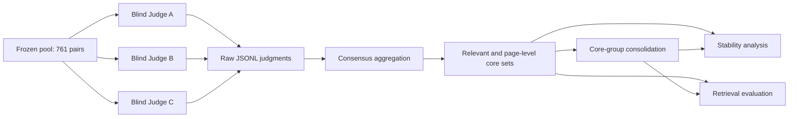

# CDIRP Research Onboarding and Frozen Judging Reproduction Guide

Status: active handoff guide
Prepared for: Peizhao, Songxi, Junshan, and CDIRP collaborators
Source: Professor Shang's "CDIRP Code Repository Sharing, Onboarding, and Weekly Progress Reporting Guide"
Repository baseline: CDIRP V3 Experimental Baseline

## 1. Purpose and required outcomes

This document turns Professor Shang's instructions into an executable repository workflow. The required outcomes are:

1. Junshan receives repository access without access to credentials.
2. Peizhao or Songxi gives a 15-20 minute walkthrough of the actual execution path.
3. Junshan independently repeats the frozen judging stage without modifying the baseline.
4. The repeat run is compared with the existing run for grade and set stability.
5. Junshan performs evidence-facet and redundancy analysis for Q3, Q7, and Q9.
6. Peizhao, Songxi, and Junshan submit written weekly reports before each group meeting.

## Public repository scope

This public repository contains the experiment code, tests, prompt/configuration definitions, the nine questions, and onboarding documentation. Frozen page text, candidate pools, judgments, qrels, system runs, and analysis outputs are retained locally and must be shared with authorized project members through an approved private channel. Their paths below describe the complete internal research package.

## 2. Frozen experiment identity

| Item | Frozen value |
|---|---|
| Candidate pool | `benchmark/pools/candidate_pool_v2_761.jsonl` |
| Candidate pairs | 761 unique query-page pairs |
| Questions | `benchmark/questions.csv`, Q1-Q9 |
| Page corpus | `benchmark/corpus_pages.jsonl` (private artifact; verify with `docs/CORPUS_ACCESS.md`) |
| Source catalog | `data/source_catalog.csv` |
| Prompt version | `core-evidence-v2-2026-09-30` |
| Judge A | `openai/gpt-5.6-sol` |
| Judge B | `anthropic/claude-sonnet-5` |
| Judge C | `gemini/gemini-3.1-pro-preview` |
| Existing parsed judgments | `benchmark/judgments_v2/` |
| Existing consensus qrels | `benchmark/qrels/consensus_qrels_v2.csv` |
| Human-reviewed groups | `benchmark/qrels/core_groups.json` |
| Reviewed evaluation | `benchmark/analysis/system_evaluation_v2_reviewed.csv` |
| Reviewed manifest | `benchmark/analysis/v2_reviewed_evaluation_manifest.json` |

The reviewed manifest records 761 qrels rows, 62 page-level core pages, and 37 human-reviewed core groups. These baseline files must remain unchanged during replication.

## 3. Repository map

| Path | Purpose |
|---|---|
| `scripts/run_llm_judges.py` | Blind page-level judging, prompt, model defaults, retries, checkpointing |
| `scripts/build_consensus_qrels.py` | Three-judge aggregation and relevant/core decisions |
| `scripts/consolidate_core_groups.py` | Provisional core-page grouping by evidence facet |
| `scripts/analyze_judge_stability.py` | Baseline versus repeat stability analysis |
| `scripts/evaluate_systems.py` | Recall, CoreRecall, CoreGroupRecall, nDCG, and MRR |
| `scripts/analyze_core_group_failures.py` | Retrieval depth, complementarity, near-miss, and failure diagnostics |
| `benchmark/pools/` | Frozen and delta candidate pools |
| `benchmark/judgments_v2/` | Frozen parsed V2 judge outputs and rationales |
| `benchmark/qrels/` | Consensus qrels and reviewed core groups |
| `benchmark/analysis/` | Evaluation tables, stability results, diagnostics, and manifests |
| `benchmark/candidate_runs/` | Frozen system candidate runs |
| `tests/` | Unit and regression tests |
| `.env.example` | Credential variable names and model overrides; no secrets |
| `V3_BASELINE_FREEZE.md` | Production V3 baseline description |
| `v3_baseline_config.json` | Machine-readable production baseline configuration |

## 4. End-to-end judging path



Each judge receives only the question, page ID, document title, and complete extracted page text. Candidate origin, retrieval rank, system identity, and selection count are hidden.

## 5. Consensus rules

For grades `r1`, `r2`, and `r3`:

- `MeanRel = (r1 + r2 + r3) / 3`
- Relevant: `MeanRel >= 2.5` and at least two judges assign grade 2 or higher.
- Page-level core: `MeanRel >= 3.5` and at least two judges assign grade 4.
- Final grade: nearest integer using half-up rounding, clamped to 0-4.
- Range: `max(r) - min(r)`.
- Variance: population variance across the three grades.

No two-judge substitution is allowed. An incomplete triplet must be reported and excluded until repaired.

## 6. Environment setup

Use Python 3.12, matching the frozen project environment.

```powershell
cd C:\Users\tony1\OneDrive\Desktop\V3\new-V3
python -m venv .venv
.\.venv\Scripts\Activate.ps1
python -m pip install -r requirements.txt
Copy-Item .env.example .env.local
```

Populate `.env.local` locally with `OPENAI_API_KEY`, `ANTHROPIC_API_KEY`, and `GEMINI_API_KEY`. Never commit credentials or provider billing details.

Before a live run:

```powershell
python -m pytest -q
```

## 7. Independent repeat run

### 7.1 Branch and output isolation

```powershell
git switch -c junshan/stability-facet-analysis
$run = "benchmark/runs/junshan_stability_YYYYMMDD"
New-Item -ItemType Directory -Force "$run/judgments", "$run/qrels", "$run/analysis" | Out-Null
git rev-parse HEAD
git status --short
python --version
python -m pip freeze | Set-Content "$run/pip-freeze.txt"
```

Do not write into `benchmark/judgments_v2/` or overwrite existing qrels.

### 7.2 Run the frozen three-judge panel

```powershell
python scripts/run_llm_judges.py `
  --pool benchmark/pools/candidate_pool_v2_761.jsonl `
  --questions benchmark/questions.csv `
  --corpus benchmark/corpus_pages.jsonl `
  --catalog data/source_catalog.csv `
  --output-dir "$run/judgments" `
  --model judge_a=openai/gpt-5.6-sol `
  --model judge_b=anthropic/claude-sonnet-5 `
  --model judge_c=gemini/gemini-3.1-pro-preview `
  --resume
```

Acceptance gate:

- Each of `judge_a.jsonl`, `judge_b.jsonl`, and `judge_c.jsonl` contains 761 valid records.
- Parsed judgments and checkpoints remain in the run-specific location.
- Current implementation gap: successful raw provider response text, per-call timestamps, and a structured retry/error event log are not all persisted. Add non-semantic audit logging before Junshan starts the official run; do not change the prompt or grading logic.
- Actual timestamps, runtime, retry counts, and provider usage are recorded.
- A quota or malformed-response failure is resumed from checkpoint; the model and prompt are not changed.

### 7.3 Build repeat consensus

```powershell
python scripts/build_consensus_qrels.py `
  --pool benchmark/pools/candidate_pool_v2_761.jsonl `
  --judgment-dir "$run/judgments" `
  --full-output "$run/qrels/consensus_qrels_v2_repeat.csv" `
  --trec-output "$run/qrels/consensus_qrels_v2_repeat.tsv"
```

The repeat CSV must contain 761 complete rows. A missing triplet is an incomplete replication, not a zero grade.

### 7.4 Create provisional repeat core groups

```powershell
python scripts/consolidate_core_groups.py `
  --qrels "$run/qrels/consensus_qrels_v2_repeat.csv" `
  --judgments "$run/judgments" `
  --questions benchmark/questions.csv `
  --catalog data/source_catalog.csv `
  --output "$run/qrels/core_groups_v2_repeat.json" `
  --model openai/gpt-5.6-sol
```

Automatically consolidated repeat groups remain provisional and do not replace `benchmark/qrels/core_groups.json`.

### 7.5 Compare stability

```powershell
python scripts/analyze_judge_stability.py `
  --baseline-judgments benchmark/judgments_v2 `
  --repeat-judgments "$run/judgments" `
  --baseline-qrels benchmark/qrels/consensus_qrels_v2.csv `
  --repeat-qrels "$run/qrels/consensus_qrels_v2_repeat.csv" `
  --baseline-groups benchmark/qrels/core_groups.json `
  --repeat-groups "$run/qrels/core_groups_v2_repeat.json" `
  --output-dir "$run/analysis/judge_stability"
```

Required comparisons, per question and overall:

- individual-judge exact grade agreement and mean absolute difference;
- consensus MeanRel correlation on common pages;
- relevant-page counts and Jaccard overlap;
- core-page counts and Jaccard overlap;
- pages changing non-relevant/relevant/core status;
- pages with high inter-judge disagreement;
- question-level concentration of instability;
- group membership and redundancy stability as secondary diagnostics.

If core overlap is much lower than relevant overlap, CoreRecall may partly reflect pseudo-gold instability. If both are stable, low CoreRecall more likely reflects retrieval or ranking failure.

## 8. Q3, Q7, and Q9 facet analysis

Create one manually reviewed table per question:

| facet_id | facet_description | core_evidence_group | page_ids | redundant_alternatives | rationale | covered_by_current_qrels |
|---|---|---|---|---|---|---|

Required focus:

- Q3: wetland status/loss, impacts/ecological significance, restoration or management progress, recommendations, and multiple-document coverage.
- Q7: species-specific strategy, Missouri breeding context, migration/wintering geography, named countries, and named partners.
- Q9: Montreal fund evidence, Cleveland fund evidence, funding structure, administrative mechanisms/advantages, and corpus-supported comparison boundaries.

Redundancy rule:

- Pages supporting essentially the same indispensable fact are alternative members of one core group.
- Pages supporting different indispensable answer components belong to different groups.
- Do not inflate the denominator by treating redundant pages as separate required facets.

Store outputs under `benchmark/runs/<run_id>/facet_analysis/` as `Q3_facets.csv`, `Q7_facets.csv`, `Q9_facets.csv`, and `review_notes.md`.

## 9. Change control

- Keep `main`, V2 artifacts, and the reviewed baseline unchanged during replication.
- Separate prompt, threshold, schema, and aggregation changes into later commits labeled as new experiments.
- Peizhao and Songxi review evaluation-affecting changes before merge.
- Never overwrite prior results; use run-specific directories.
- Record branch, commit, run ID, prompt version, model IDs, command line, timestamps, retries, and paths.
- A dirty working tree is not a frozen reproducibility point.

## 10. Known limitations

- Frontier APIs can vary across repeated calls even with unchanged inputs.
- Quotas, aliases, and service availability can affect completion time.
- Core-group consolidation is provisional until human review.
- Free-text facet labels can vary even when page membership agrees.
- Copilot has only 16 sponsor-supplied candidates and cannot support Top-20/50/100 depth claims.
- OneDrive/Windows can deny pytest cache writes; record this separately from assertion results.
- The judging runner currently persists parsed outputs and checkpoints, but not the complete per-call audit record required by Professor Shang. This must be resolved before the official independent rerun.
- Secrets must not be included in the shared research package.

## 11. Handoff acceptance checklist

- [ ] Junshan has repository access and branch permission.
- [ ] No credentials were shared.
- [ ] Walkthrough completed using `docs/CODE_WALKTHROUGH_CHECKLIST.md`.
- [ ] Frozen pool, prompt, models, and thresholds confirmed.
- [ ] Separate branch and run directory created.
- [ ] Per-call audit logging records raw response, parsed judgment, timestamp, run ID, attempt, and errors.
- [ ] Three raw judgment files each contain 761 valid pairs.
- [ ] Repeat consensus contains 761 complete rows.
- [ ] Stability comparison generated per question and overall.
- [ ] Q3/Q7/Q9 facet tables completed and manually reviewed.
- [ ] Peizhao and Songxi reviewed findings before any baseline change.
- [ ] Weekly reports submitted before meetings and prior weeks preserved.
